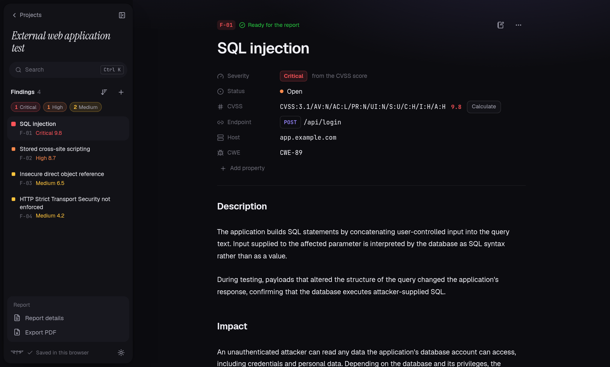

<p align="center">
  <picture>
    <source media="(prefers-color-scheme: dark)" srcset="docs/banner-dark.png">
    
  </picture>
</p>

# Findingsmith, by 0xExploitLabs

Findingsmith is a penetration test report writer that runs entirely in your browser.
You write each finding like a note, give it a CVSS vector and your evidence, and download a typeset PDF your client can read.
There is no account and no server: your projects live in your browser and never leave your device.

Made by [0xExploitLabs](https://0xexploitlabs.org).
Use it at [findingsmith.0xexploitlabs.org](https://findingsmith.0xexploitlabs.org).



## Why

Most of a pentest report is formatting.
The findings are already in your notes, and the hours go into moving them to a Word template, fixing the numbering and arguing with tables.

Findingsmith lets you write the report the way you take notes and lays it out for you.
Because nothing is uploaded, you can use it on an engagement without asking anyone where client data ends up.

## What you get

- **An editor that feels like a notes app.**
  Findings are Markdown with live preview: the markup hides itself and the text looks like the report.
  Type `/` for headings, tables, checklists, images and code blocks in any language.
  A table is a grid you fill in cell by cell, and an empty section tells you what belongs in it.
- **Evidence where it belongs.**
  Paste or drop screenshots straight into a finding.
  HTTP requests and responses get their own highlighted blocks.
- **A library of 50 findings.**
  SQL injection, stored XSS, IDOR, weak TLS and the rest come pre-written with a description, impact, remediation, references, a CWE and a CVSS vector.
  Add one and change what is different on your engagement.
- **Severity you can defend.**
  Paste a CVSS 3.1 or 4.0 vector, build one in the calculator, or type a bare score.
  The severity follows the score, so a 5.3 is always Medium.
  Rate a finding differently and the report prints both ratings and your reason.
- **A report, not a printout.**
  The PDF has a cover, linked contents, an executive summary with a risk overview, a findings table, one section per finding and a severity appendix.
  You choose its colour and logo.
  No tool name or watermark appears anywhere in the file.
- **Checks before you send.**
  Findingsmith tells you which findings still lack a title, a write-up, remediation or a score.
- **Your data stays yours.**
  Everything is stored in your browser's IndexedDB.
  Export a project to one file to back it up or move it to another browser.
  Private notes on a finding are never printed.
- **Fast to move around.**
  Ctrl+K (Cmd+K on macOS) jumps to any finding or command, and Ctrl+\ folds the sidebar away.
  Light and dark themes, and a layout that works on a phone.

## How a report is put together

A project has two kinds of document.

**Report details** hold what comes before the findings: the title, the dates, and sections such as the executive summary, scope and methodology.
Each `## Heading` becomes a numbered section of the report.
A section with "summary" in its title opens the report next to the risk overview, and one titled "Conclusion" closes it after the findings.

**Findings** work the same way.
Their `##` sections, usually Description, Impact, Steps to reproduce, Remediation and References, are printed in the order you write them.
Sections left empty are skipped.
Findings are ordered by severity and numbered `F-01`, `F-02` and so on.

## Severity scale

| CVSS base score | Severity |
| --------------- | -------- |
| 9.0 to 10.0     | Critical |
| 7.0 to 8.9      | High     |
| 4.0 to 6.9      | Medium   |
| 0.1 to 3.9      | Low      |
| 0.0             | Info     |

CVSS 3.1 scores follow the base score formula of the specification.
CVSS 4.0 scores use the macrovector lookup published by FIRST.
A malformed vector is rejected instead of scored.

## Run it

You need Node.js 22 or later and pnpm.

```sh
git clone https://github.com/0xExploitLabs/findingsmith.git
cd findingsmith
pnpm install
pnpm dev
```

Open the address Vite prints.

To host it yourself, run `pnpm build` and serve the `dist/` folder from any static host.
There is no backend to set up.
The repository includes a `wrangler.jsonc` for Cloudflare, which serves `dist/` as static files.

## Contributing

Contributions are welcome, from a typo fix to a new feature.

Good places to start:

- **The finding library.**
  Add a finding you write up often, or improve the wording of an existing one.
  Entries live in `src/data/library.ts` and each one needs a CVSS 3.1 vector.
- **The PDF.**
  Layout and typography improvements to the report in `src/pdf`.
- **Bugs and rough edges.**
  If something looks off or behaves oddly, open an issue with what you did and what you saw, or send the fix.

How to send a change:

1. Fork the repository and create a branch from `main`.
2. Make your change, and add or update a test when it changes behaviour.
3. Run the checks below until they pass.
4. Open a pull request that says what the problem was and how you checked the fix.

For anything large, open an issue first so we can agree on the direction before you spend the time.

```sh
pnpm check       # lint and format (pnpm fix applies the fixes)
pnpm typecheck   # TypeScript
pnpm test        # unit tests
pnpm e2e         # browser tests against the production build
```

The browser tests use Playwright's Chromium.
To use one you already have, set `CHROMIUM_PATH`, for example `CHROMIUM_PATH=/usr/bin/chromium pnpm e2e`.

A few conventions keep the code consistent:

- Commit messages follow `type(scope): what changed`, such as `fix(pdf): keep a table row on one page`.
- User-facing text is plain and short, and empty fields show an example instead of an instruction.
- Nothing may send report data anywhere: no analytics, no remote fonts, no network calls with project content.

## Security

Please do not report vulnerabilities in public issues.
See [SECURITY.md](SECURITY.md) for how to report one.

## License

The code is licensed under either of [MIT](LICENSE-MIT) or [Apache-2.0](LICENSE-APACHE), at your option.
Unless you say otherwise, any contribution you submit is licensed the same way.

Fonts bundled in `public/fonts` keep their own licenses:

- JetBrains Mono, SIL Open Font License 1.1, see `LICENSES/OFL-1.1-JetBrainsMono.txt`.
- Noto Sans, a Latin, Greek and Cyrillic subset used as the PDF fallback, SIL Open Font License 1.1, see `LICENSES/OFL-1.1-NotoSans.txt`.
- Geist and Instrument Serif, the interface typefaces, SIL Open Font License 1.1, installed from the `@fontsource` packages.
- 0x Sans, used in the PDF only, is the 0xExploitLabs brand typeface and is not covered by the code license.
